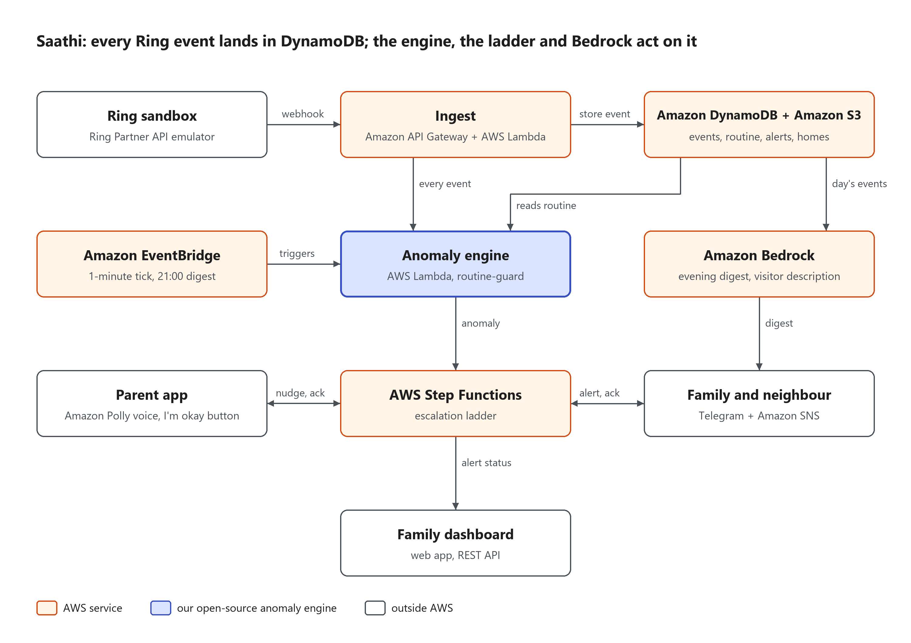

# Saathi

Elder-care guardian built on Ring.

> **Your parents live alone. Saathi notices when their day isn't normal, and makes sure someone
> checks in.**

## Overview

Millions of Indian parents live alone while their children work in other cities. Today the
family finds out something went wrong only when Papa stops picking up the phone.

Saathi ("companion") learns a parent's normal daily rhythm from Ring motion and doorbell events:
up around seven, kitchen by eight, the front door for the milk. When the day stops looking normal,
it climbs an escalation ladder. First it gently asks the parent, then it alerts the family, then
a neighbour, until someone checks in. Every evening the family gets a short AI-written summary of
the day, and unknown doorbell visitors are flagged, because scam visits target older people living
alone.

Built for the Amazon Developer Hackathon 2026. Primary track: **Ring**; mini challenges: **AWS
Builder** and **Open Source**.

## Features

| Feature | What it does | Status |
|---|---|---|
| Routine learning | 96 fifteen-minute slots per zone (front door, kitchen, living room, bedroom) over 14 days, plus the median and spread of the first activity of the day | works |
| Anomaly detection | **Late start** (kitchen or bedroom quiet past the usual time + buffer), **long inactivity** (4 h without movement while awake), **night activity** (front door at a rarely used hour), each with a one-sentence reason | works |
| Escalation ladder | Grace period → voice nudge to the parent → Telegram alert to the family → neighbour; any acknowledgement resolves it | works locally; real Telegram delivery not yet verified on a phone |
| Parent app | A big clock; when nudged, "Are you okay?" in large text, the Polly voice and one huge "I'm okay" button; English and हिन्दी | works |
| Evening digest | Amazon Bedrock writes the day's summary at 21:00 | template fallback works; live Bedrock pending model access |
| Visitor description | Amazon Bedrock describes the doorbell snapshot; strangers with no uniform and no package are flagged | built; live Bedrock pending model access |
| Family dashboard | Live status (green / yellow / red), today's timeline with doorbell snapshots, alerts with every escalation step, digest, routine charts; works on mock data or the real API | works; verified against the real API |
| Demo scenarios | Six scripted days for the Ring emulator: normal, fall, late morning, 2 am door, scam visitor, carer's visit | works |

## Architecture



Every Ring event enters through one webhook and lands in DynamoDB; everything else reads from
there.

1. **Ring → Ingest.** The Ring sandbox (an emulator of the Ring Partner API) sends HMAC-signed
   webhooks to the ingest Lambda behind API Gateway. Ingest verifies the signature, normalizes
   the event, stores it and updates the routine. It also runs the night check on every event and
   fetches doorbell snapshots with `RingClient`.
2. **Engine.** EventBridge runs a tick every minute that checks for what *didn't* happen (late
   start, long inactivity). The engine is our open-source library
   [routine-guard](docs/OPEN_SOURCE_ENGINE.md): plain statistics, O(1) per event.
3. **Escalation.** An anomaly opens an alert, and AWS Step Functions runs the ladder with
   callback tokens, so an "I'm okay" (parent app) or "I'm checking" (Telegram) resolves it
   instantly. Amazon Polly voices the nudge.
4. **AI.** Amazon Bedrock writes the 21:00 digest and describes doorbell visitors.

Locally, the same handlers run in one FastAPI app with an in-memory store and asyncio timers in
place of Step Functions. More detail: [docs/BACKEND.md](docs/BACKEND.md),
[docs/ESCALATION.md](docs/ESCALATION.md), [docs/CONTRACTS.md](docs/CONTRACTS.md). The diagram's
source is [docs/architecture.excalidraw](docs/architecture.excalidraw) (opens in excalidraw.com).

## Quick start

Requirements: Python 3.11+, Node 20+, Git. Everything runs locally with no AWS account
(`STORAGE=memory`).
On Windows, clone into a short path (e.g. `C:\src\saathi`) or enable long paths: some of
boto3's data files exceed the 260-character limit inside a deep folder.

```bash
git clone https://github.com/mayank-ydvv/saathi.git
cd saathi
python -m venv .venv
source .venv/bin/activate            # Windows (Git Bash): source .venv/Scripts/activate
pip install -e ".[dev]"              # Windows also needs: pip install tzdata
cp .env.example .env
pytest                               # backend, engine and scenario tests
```

Run a whole demo day (emulator, API, seeded home, 14 learned days, then the scenario):

```bash
scripts/demo_run.sh fall_day         # Ctrl-C to stop
```

Or run everything connected with one command: the demo above plus the landing page, and the
dashboard and parent app on the real API (`VITE_USE_MOCK=false`). Ctrl-C stops it all.

```bash
scripts/run_all.sh                   # fall_day; or e.g. scripts/run_all.sh night_door
```

| App | URL |
|---|---|
| Landing page (links to the other two) | http://localhost:5175 |
| Family dashboard (create a demo account; the code is shown on screen) | http://localhost:5173 |
| Parent app | http://localhost:5174 |
| API | http://localhost:8000 |

To run the apps one at a time instead, start the parent app in a second terminal:

```bash
cd parent-app
npm install
echo "VITE_USE_MOCK=false" > .env.local
npm run dev                          # http://localhost:5174
```

Leave out `.env.local` to run the parent app on its own with a mock nudge after 10 seconds.

And the family dashboard:

```bash
cd dashboard
npm install
echo "VITE_USE_MOCK=false" > .env.local
npm run dev                          # http://localhost:5173
```

Leave out `.env.local` to run it on mock data; the **Demo** switch in its top bar (Normal ·
Checking · Alert) shows each state. More in [dashboard/README.md](dashboard/README.md).

## Running the demo scenarios

`scripts/demo_run.sh <scenario>` plays one scripted day through the real backend on a demo clock.
Expected results:

| Scenario | What happens | Saathi's response |
|---|---|---|
| `normal_day` | Kamala's ordinary day | stays green; evening digest |
| `fall_day` | last movement at 13:00, then silence | **long inactivity** → nudge → family → neighbour |
| `late_morning` | up at 06:50 but no kitchen until 10:40 | **late start (kitchen)** → ladder |
| `night_door` | front door at 02:10 | **night activity** → ladder |
| `scam_visitor` | unknown man at the doorbell, no package | no routine alert; visitor described and flagged |
| `aide_visit` | home aide 10:00–11:30 | no alert |

Scenario files, device setup, play speeds and the emulator's limits:
[sandbox/scenarios/README.md](sandbox/scenarios/README.md). End-to-end results:
[docs/E2E_RESULTS.md](docs/E2E_RESULTS.md).

## AWS deployment

One AWS SAM stack holds four DynamoDB tables, an S3 bucket, an HTTP API, five Lambdas, two
EventBridge schedules, the Step Functions state machine and an SNS topic:

```bash
cd infra
sam build
sam deploy --guided
```

Parameters, seeding and pointing the Ring webhook at the deployed API:
[infra/README.md](infra/README.md). AWS services used and how: [docs/FEEDBACK.md](docs/FEEDBACK.md).

## Open source

- **[routine-guard](https://github.com/krishnadityasingh18-create/routine-guard)** (MIT): Saathi's
  anomaly engine as a standalone Python library ([details](docs/OPEN_SOURCE_ENGINE.md)).
- **[Elder-care scenarios for ring-sandbox](https://github.com/josepha-mayo/ring-sandbox/pull/19)**:
  night wandering, an unanswered door and a doorstep stranger, contributed to the Ring Partner
  API emulator we built on.

Devpost fields for both: [docs/OPEN_SOURCE.md](docs/OPEN_SOURCE.md).

## Team

| Name | Role |
|---|---|
| Mayank | Backend, AWS infrastructure, escalation, integration |
| Krishnaditya | Anomaly engine, Bedrock digest and visitor description, routine-guard |
| Anushka | Family dashboard |
| Debadrita | Demo scenarios, parent app, docs, demo video, ring-sandbox contribution |

## License

[MIT](LICENSE)
